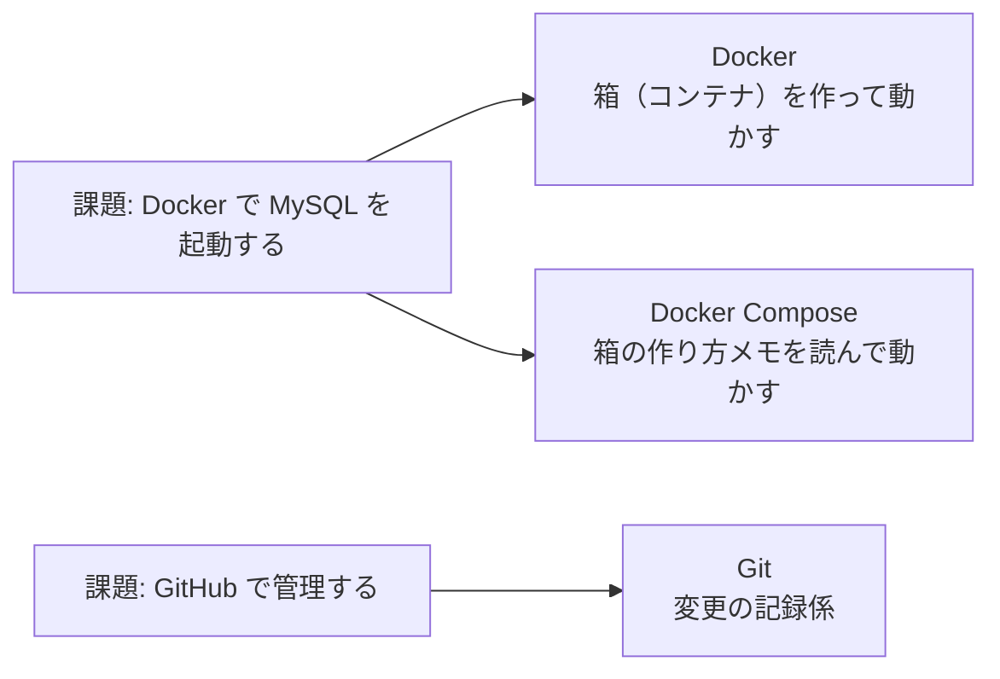
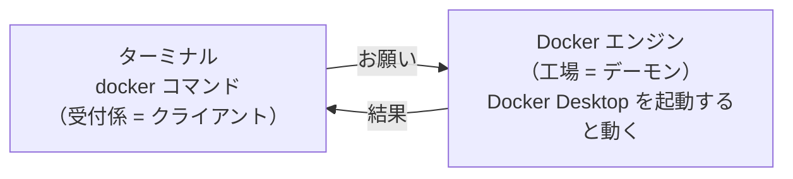

# 学習ノート

各ステップで学んだことをまとめる。
Claude が下書きし、自分で読んで分かりやすい言葉に直していく。

---

## ステップ 1: 必要な道具（2026-11-12）

### 課題から逆算すると、なぜこの道具が必要か



| 道具 | ひとことで言うと | 確認したバージョン |
|---|---|---|
| Git | ファイルの変更を記録する係 | 2.49.0 |
| Docker | アプリを「箱（コンテナ）」に入れて動かす道具 | 29.6.2 |
| Docker Compose | 箱の作り方メモ（設定ファイル）を読んで、まとめて動かす道具 | v5.3.1 |

### 道具があるかの確かめ方

道具に「バージョンは？」と聞く。答えが返ってくればインストールされている。
`command not found` と出たら、入っていない。

```bash
git --version            # Git に聞く
docker --version         # Docker に聞く
docker compose version   # Docker Compose に聞く（ここだけ "--" が付かない）
```

実務では、新しいプロジェクトに参加したら最初にこれを確認する。
README に「必要な道具とバージョン」が書いてあることが多い。

### Docker は「受付係」と「工場」に分かれている



- **クライアント（受付係）**: ターミナルで打つ `docker` コマンドのこと
- **デーモン（工場）**: 裏で待機して、実際にコンテナを作ったり動かしたりするプログラム

| コマンド | Docker Desktop が止まっているとき |
|---|---|
| `docker --version` | 答えが返る（受付係が自分の版を言うだけなので） |
| `docker ps` / `docker run` など | エラーになる（工場に頼む必要があるので） |

止まっているときに出るエラー:

```
Cannot connect to the Docker daemon at unix:///... Is the docker daemon running?
```

→ **「Docker Desktop を起動し忘れているかも」と考える。**

### Git: ブランチの使い方

- `git switch -c <名前>` … 新しいブランチを作って、そこに移る（`-c` = create）
- ターミナルの行頭の `git:(○○)` に、今いるブランチが表示される。作業の前に見るクセをつける
- PR でマージしたブランチは、消しても中身は `main` に残る。実務ではマージ後に消すのが普通

### 参考リンク

- Docker 公式「Docker のアーキテクチャ」: https://docs.docker.com/get-started/docker-overview/#docker-architecture
- Docker 公式 `docker version`: https://docs.docker.com/reference/cli/docker/version/
- Docker 公式 Docker Compose とは: https://docs.docker.com/compose/
- Pro Git（日本語）ブランチとは: https://git-scm.com/book/ja/v2/Git-のブランチ機能-ブランチとは
