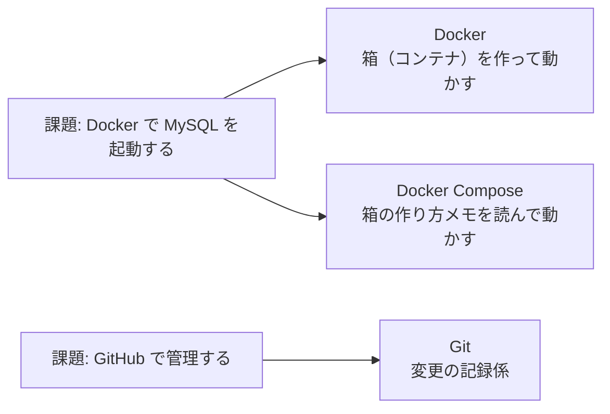
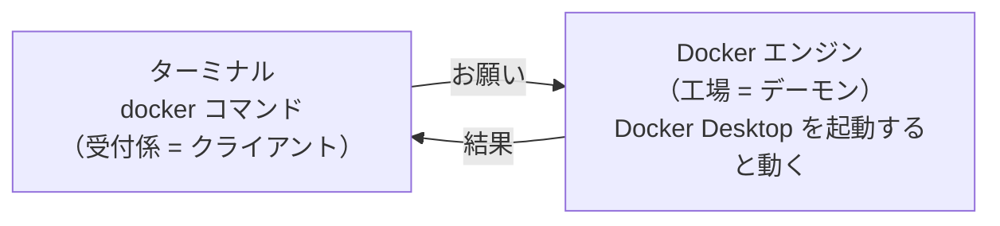
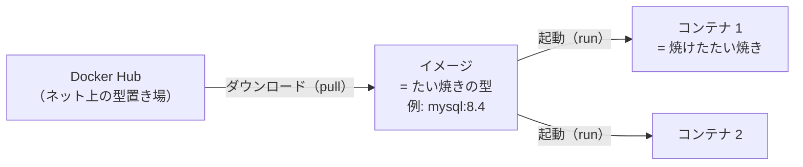

# 学習ノート

各ステップで学んだことをまとめる。
Claude が下書きし、自分で読んで分かりやすい言葉に直していく。

---

## ステップ 1: 必要な道具（2026-11-12）

### 課題から逆算すると、なぜこの道具が必要か



| 道具 | ひとことで言うと | 確認したバージョン |
|---|---|---|
| Git | ファイルの変更を記録する係 | 2.49.0 |
| Docker | アプリを「箱（コンテナ）」に入れて動かす道具 | 29.6.2 |
| Docker Compose | 箱の作り方メモ（設定ファイル）を読んで、まとめて動かす道具 | v5.3.1 |

### 道具があるかの確かめ方

道具に「バージョンは？」と聞く。答えが返ってくればインストールされている。
`command not found` と出たら、入っていない。

```bash
git --version            # Git に聞く
docker --version         # Docker に聞く
docker compose version   # Docker Compose に聞く（ここだけ "--" が付かない）
```

実務では、新しいプロジェクトに参加したら最初にこれを確認する。
README に「必要な道具とバージョン」が書いてあることが多い。

### Docker は「受付係」と「工場」に分かれている



- **クライアント（受付係）**: ターミナルで打つ `docker` コマンドのこと
- **デーモン（工場）**: 裏で待機して、実際にコンテナを作ったり動かしたりするプログラム

| コマンド | Docker Desktop が止まっているとき |
|---|---|
| `docker --version` | 答えが返る（受付係が自分の版を言うだけなので） |
| `docker ps` / `docker run` など | エラーになる（工場に頼む必要があるので） |

止まっているときに出るエラー:

```
Cannot connect to the Docker daemon at unix:///... Is the docker daemon running?
```

→ **「Docker Desktop を起動し忘れているかも」と考える。**

### Git: ブランチの使い方

- `git switch -c <名前>` … 新しいブランチを作って、そこに移る（`-c` = create）
- ターミナルの行頭の `git:(○○)` に、今いるブランチが表示される。作業の前に見るクセをつける
- PR でマージしたブランチは、消しても中身は `main` に残る。実務ではマージ後に消すのが普通

### 参考リンク

- Docker 公式「Docker のアーキテクチャ」: https://docs.docker.com/get-started/docker-overview/#docker-architecture
- Docker 公式 `docker version`: https://docs.docker.com/reference/cli/docker/version/
- Docker 公式 Docker Compose とは: https://docs.docker.com/compose/
- Pro Git（日本語）ブランチとは: https://git-scm.com/book/ja/v2/Git-のブランチ機能-ブランチとは

---

## ステップ 2: イメージとコンテナ（2026-11-14）

### たとえ: たい焼きの型と、焼けたたい焼き



| | イメージ | コンテナ |
|---|---|---|
| たとえ | たい焼きの型（設計図） | 焼けたたい焼き（実物） |
| 動く？ | 動かない | **この中で MySQL が動く** |
| 変更 | できない（読み取り専用） | できる（データを入れたりする） |
| 数 | 1 つ | 同じイメージから何個でも作れる |
| 消すと？ | — | コンテナを消しても、イメージは残る |

- `mysql:8.4` の `:8.4` の部分は **タグ**。「どのバージョンの型か」を示す名札

### 手元にあるものを見るコマンド

| コマンド | 何を見る？ |
|---|---|
| `docker images` | 手元にある**イメージ**の一覧（型の棚） |
| `docker ps` | **動いている**コンテナの一覧 |
| `docker ps -a` | **止まっているもの**も含めた、全部のコンテナの一覧（`-a` = all） |

どれも「見るだけ」なので、打っても何も変わらない。

結果の見方:

- `docker images` の `EXTRA` 列の `U` = In Use。**このイメージから作ったコンテナがある**という印
- `docker ps -a` の `STATUS` 列
  - `Up ...` = 動いている
  - `Exited ...` = 止まっている（`docker ps` だけだと表示されない）

実務では「ちゃんと動いてる？」と思ったら、まず `docker ps` を打つ。トラブル時の最初の確認。

### 参考リンク

- Docker 公式 What is an image?: https://docs.docker.com/get-started/docker-concepts/the-basics/what-is-an-image/
- Docker 公式 What is a container?: https://docs.docker.com/get-started/docker-concepts/the-basics/what-is-a-container/
- Docker Hub MySQL 公式イメージ: https://hub.docker.com/_/mysql
- CircleCI「Docker のイメージとコンテナ: どう違う？」(2022): https://circleci.com/ja/blog/docker-image-vs-container/
- Zenn「Dockerと仮想化の基本整理【初心者向けまとめ】」(2025): https://zenn.dev/kmj13/articles/docker_virtualization_ja
- Docker 公式 `docker image ls`（= `docker images`）: https://docs.docker.com/reference/cli/docker/image/ls/
- Docker 公式 `docker container ls`（= `docker ps`）: https://docs.docker.com/reference/cli/docker/container/ls/

### MySQL のバージョンとタグの選び方

| 系統 | 特徴 | Docker Hub のタグ（2026-11 時点） |
|---|---|---|
| LTS（長期サポート版） | 機能は変わらず修正だけ入る。サポートが長い（約 8 年） | `9.7`（= `lts`）、`8.4` |
| Innovation（新機能版） | 新機能が入る。次の版が出たらサポート終了 | `26.10`（= `innovation` = `latest`） |

- 2026 年 7 月から、バージョン番号が「年.月」の形になった（`26.10` = 2026 年 10 月版）。`9.7` が連番のラスト
- `latest` は貼り替えられ続ける名札。ダウンロードした時期で中身が変わるので、実務では使わず `mysql:9.7` のように番号を書く
- 今回は **`mysql:9.7`** を使うことにした（本番環境でも選ばれやすい安定版）

参考: MySQL 公式 Innovation and LTS: https://dev.mysql.com/doc/refman/26.10/en/mysql-releases.html
